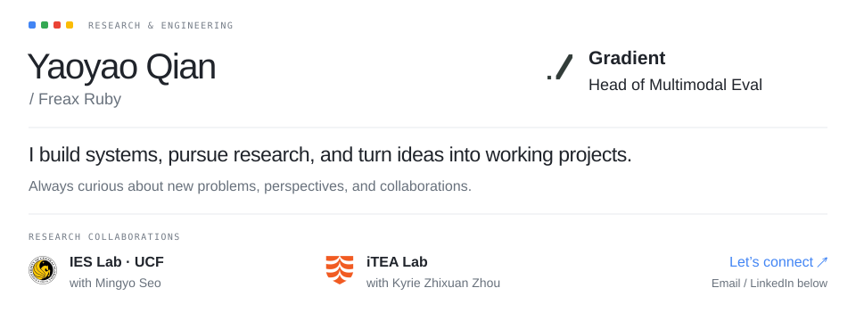

[Website](https://h-freax.github.io/) · [Scholar](https://scholar.google.com/citations?user=E0rCXLIAAAAJ) · [LinkedIn](https://www.linkedin.com/in/rubyfreax) · [Email](mailto:qian.yao@northeastern.edu)
